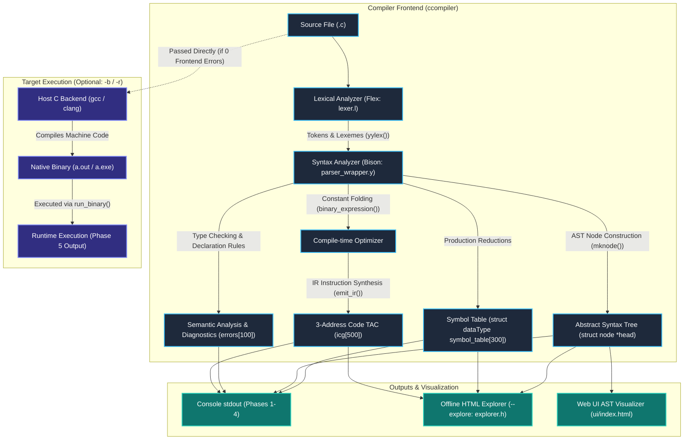

# Compiler Design ISE — Project Overview & Architecture Guide

## 1. Executive Summary & Purpose

This project is an **Educational C Compiler Frontend and Program Execution Toolchain** implemented in **C**, using **Flex (Fast Lexical Analyzer)** and **Bison (LALR Parser Generator)**.

The software serves two primary purposes:
1. **Educational Compiler Frontend**: It provides an end-to-end implementation of classical compiler frontend phases:
   - **Lexical Analysis (Scanner)**: Tokenizes source code, handles comments and whitespace, detects overlong tokens, and builds initial symbol entries.
   - **Syntax Analysis (Parser)**: Validates input according to an extended ANSI C context-free grammar, builds an Abstract Syntax Tree (AST) represented as a binary tree, and displays inorder traversals.
   - **Semantic Analysis**: Enforces static type checking, undeclared variable detection, duplicate declaration checks, keyword shadowing prevention, implicit type conversions, and compile-time divide-by-zero checks.
   - **Symbol Table Management**: Maintains identifiers, data types, entry categories, declaration line numbers, and compile-time estimated values.
   - **Intermediate Code Generation (IR)**: Produces linear Three-Address Code (TAC) with synthesized temporary variables (`t0`, `t1`, ...) and jump labels (`L0`, `L1`, ...).
   - **Compile-Time Optimization**: Implements compile-time constant folding and constant propagation across arithmetic, logical, bitwise, unary, and ternary operations.
   - **Interactive Diagnostics & Visualization**: Generates an interactive, standalone HTML **Compiler Explorer** with collapsible AST trees, searchable symbol tables, and an interactive IR microscope.
2. **Program Execution Driver**: For full end-to-end execution (`-r` / `--run` or `-b` / `--build`), the tool acts as an orchestrator by compiling the validated C source using a native host backend compiler (`gcc` or `clang`) and executing the resulting native binary, displaying runtime output and exit codes.

---

## 2. Language Subset & Supported Features

The compiler accepts a substantial educational subset of the C programming language:

### Data Types & Type Specifiers
- Primitive types: `int`, `float`, `double`, `char`, `void`.
- Modifiers: `long`, `short`, `unsigned`, `signed`, `const`.
- Derived types: Single-level pointers (`int*`, `char*`), 1D arrays (`int arr[10]`), and 2D arrays (`int mat[3][3]`).

### Control Flow Constructs
- Conditional statements: `if (...) { ... }` and `if (...) { ... } else { ... }`.
- Selection statements: `switch (...) { case ...: ... default: ... }`.
- Loops: `while (...) { ... }`, `do { ... } while (...);`, and `for (init; cond; update) { ... }`.
- Jump statements: `break;`, `continue;`, `return <expr>;`, `return;`.

### Operators & Expressions
- Arithmetic: `+`, `-`, `*`, `/`, `%`
- Relational: `<`, `>`, `<=`, `>=`, `==`, `!=`
- Logical: `&&`, `||`, `!`
- Bitwise: `&`, `|`, `^`, `~`, `<<`, `>>`
- Assignments: `=`, `+=`, `-=`, `*=`, `/=`, `%=`
- Increments / Decrements: `++`, `--` (prefix and postfix)
- Ternary conditional: `cond ? expr1 : expr2`
- Operator `sizeof(type)` and `sizeof(expr)` (evaluates to constant `4`)
- Explicit type casting: `(int)x`, `(float)y`

### Functions & I/O
- Function definitions with return types and parameter lists.
- Implicit declaration whitelist for 47 C standard library functions (`printf`, `scanf`, `strlen`, `strcpy`, `malloc`, `free`, `exit`, `sqrt`, `rand`, etc.).
- Preprocessor directives: `#include <...>` or `#include "..."` recognized as header symbols; `#define` skipped safely.

---

## 3. Technology Stack & Toolchain

| Tool / Technology | Version / Standard | Role in Project |
|---|---|---|
| **Flex** | `>= 2.5.x` | Generates the lexical analyzer (`lex.yy.c`) from regular expression specifications in `compiler/lexer.l`. |
| **Bison** | `>= 2.3` / `3.x` | Generates the LALR(1) parser (`y.tab.c`, `y.tab.h`) from BNF grammar rules in `compiler/parser_wrapper.y`. |
| **C Language** | `C99` / `C11` | Core implementation language for CLI driver, data structures, symbol table, AST nodes, and explorer generator. |
| **GCC / Clang** | Any native host compiler | Acts as the build system compiler and the execution backend compiler (`find_c_backend()`). |
| **Make** | GNU Make | Builds Linux/macOS executable binaries and manages targets (`all`, `test`, `clean`). |
| **HTML5 / CSS / Vanilla JS** | Web Standards | Renders the offline Compiler Explorer report (`cli/explorer.h`) and Web UI visualizer (`ui/index.html`). |
| **Python 3** | `>= 3.8` | Runs the automated cross-platform regression test suite (`tests/test_regressions.py`). |

---

## 4. Repository File Map & Responsibilities

```
Compiler/
├── Makefile                          # Build configuration for Unix/Linux/macOS
├── build-linux.sh                    # Standalone shell build script
├── build-windows.bat                 # Windows CMD batch build script
├── build-windows.ps1                 # Windows PowerShell build script with toolchain auto-detection
├── START_HERE.md                     # Quickstart instructions for evaluators
├── README.md                         # Detailed project documentation and feature list
├── ccompiler                         # Compiled native executable binary (CLI driver)
│
├── compiler/                         # Core compiler frontend
│   ├── lexer.l                       # Flex specification: regular expressions, token definitions, line counting
│   ├── parser_wrapper.y              # Bison grammar: productions, AST construction, Symbol Table, IR generation
│   ├── lex.yy.c                      # Pre-generated C source of the lexical analyzer
│   ├── y.tab.c                       # Pre-generated C source of the LALR(1) parser
│   └── y.tab.h                       # Pre-generated token and union definitions header
│
├── cli/                              # Command-line interface and reporting
│   ├── main.c                        # Entry point: argument parsing, interactive mode, driver, backend invocation
│   └── explorer.h                    # Standalone single-file HTML Compiler Explorer report generator
│
├── examples/                         # Verification programs & test cases
│   ├── simple.c                      # Minimal C program (variables, assignment, return)
│   ├── arithmetic.c                  # Basic arithmetic, float operations, type promotions
│   ├── conditionals.c                # If-else and nested conditional constructs
│   ├── loops.c                       # For, while, and do-while loops
│   ├── even_odd.c                    # Interactive console input program using scanf and modulus
│   ├── strings.c                     # String literals and character arrays
│   ├── type_conversion.c             # Mixed integer/float expressions and explicit casts
│   ├── input1.c, input2.c, input3.c  # Additional test benchmarks
│   ├── error_syntax.c                # Syntax error benchmark (missing semicolon)
│   ├── error_undeclared.c            # Semantic error benchmark (use before declaration)
│   └── error_redeclaration.c         # Semantic error benchmark (duplicate variable declaration)
│
├── tests/                            # Validation and quality assurance
│   ├── test_regressions.py           # 21 automated regression test cases in Python unittest
│   ├── run-tests.sh                  # Shell test runner script
│   ├── run-tests-win.ps1             # PowerShell test runner script
│   └── VALIDATION.md                 # Test matrix, platform results, and documented limitations
│
└── ui/                               # Interactive visualizers
    ├── index.html                    # Browser-based AST and Symbol Table graphical explorer
    └── explorer-example.html         # Pre-rendered offline sample Compiler Explorer report
```

---

## 5. Main Entry Point & Complete Execution Flow

The entry point of the application is located in `cli/main.c:495` (`main(int argc, char* argv[])`).

### Step-by-Step Flow:
1. **Interactive vs CLI Dispatch**:
   - If `argc == 1`, `main()` invokes `interactive_mode()` (`cli/main.c:356`), presenting an interactive numbered menu for users running the executable directly in a console.
   - If CLI arguments are provided, flags are parsed:
     - Output flags: `--tokens`, `--symbols`, `--parse-tree`, `--semantic`, `--ir`, `--all`, `-q`.
     - Action flags: `-b` (build binary), `-r` (build and run binary), `--explore` (generate HTML report), `-o <file>` (redirect output).
2. **Analysis Initialization (`analyze_file()`, `cli/main.c:197`)**:
   - `reset_compiler_state()` is called (`compiler/parser_wrapper.y:757`): clears all allocated symbol table entries, zeroes out diagnostic arrays, resets IR counters (`ic_idx=0`, `temp_var=0`, `label=0`), and resets `yylineno = 1`.
   - The source file is opened via `fopen(input_file, "r")` and bound to the Flex file pointer `yyin`.
   - Flex's internal buffer is refreshed via `yyrestart(yyin)`.
3. **Parsing & Reduction (`yyparse()`, `compiler/parser_wrapper.y`)**:
   - `yyparse()` repeatedly calls `yylex()` (`compiler/lexer.l`).
   - For every token matched, `lexer.l` copies the token lexeme into `yylval.nd_obj.name` and optionally logs the token if `--tokens` is active.
   - When grammar productions reduce:
     - `add_symbol()` inserts identifiers, headers, functions, and constants into `symbol_table`.
     - `check_declaration()` validates that identifiers are defined before use.
     - `binary_expression()` checks type compatibility, performs constant folding, creates AST nodes with `mknode()`, and emits 3-Address Code with `emit_ir()`.
     - Control flow constructs generate branch instructions (`if ... GOTO ...`, `LABEL ...`).
4. **Post-Parse Reporting**:
   - If `yyparse() == 0` (parsing succeeded), `print_analysis_results()` (`compiler/parser_wrapper.y:781`) prints Phase 1 (Symbol Table), Phase 2 (Parse Tree inorder traversal), Phase 3 (Semantic Diagnostics), and Phase 4 (Three-Address Code).
   - If `--explore` was requested, `write_explorer()` (`cli/explorer.h:32`) writes a self-contained HTML file embedding source code, searchable symbol table, collapsible AST tree, diagnostics, and interactive IR stepper.
5. **Backend Compilation & Program Execution (Phase 5)**:
   - If `-b` or `-r` is set, `cli/main.c` checks whether any frontend errors occurred (`parse_result != 0` or `sem_errors > 0`). If frontend errors exist, execution halts.
   - `find_c_backend()` searches the host system for `gcc` or `clang`.
   - `run_backend_compiler()` invokes `gcc -o <target_bin> <input_file>`.
   - If `-r` is active, `run_binary()` executes the target binary as a child process using `fork()` + `execvp()` on Unix / macOS, or `_spawnvp()` on Windows, printing the program's console output and exit code.

---

## 6. End-to-End Architectural Pipeline


